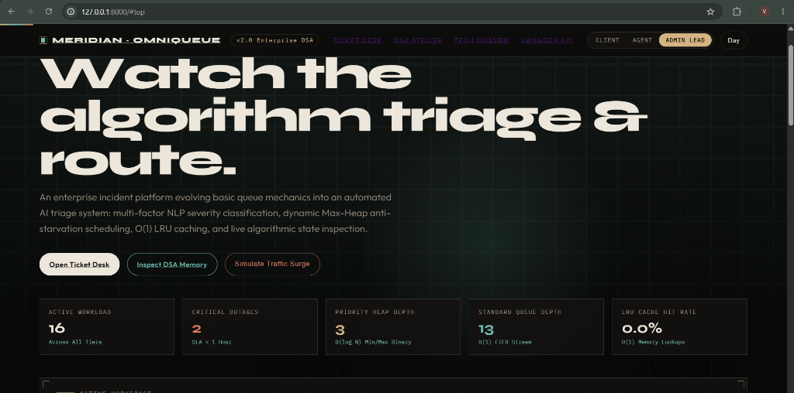
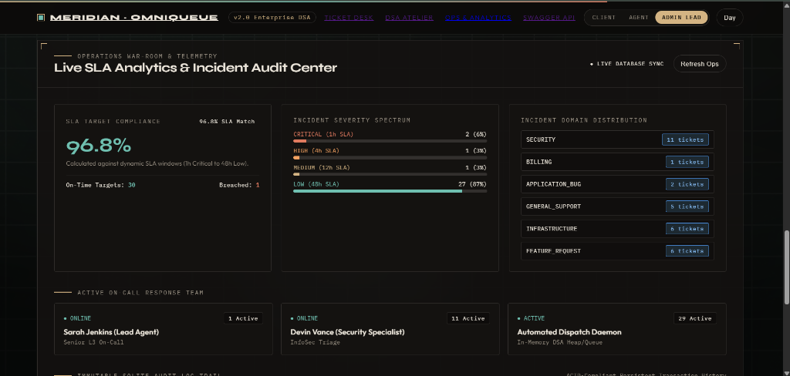
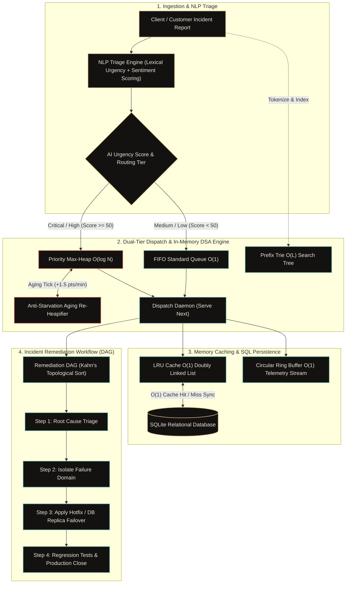

# Meridian · OmniQueue
### Enterprise Incident Orchestration Platform & AI Triage Engine

[](https://meridian-omniqueue.vercel.app)
[](https://fastapi.tiangolo.com/)
[](https://www.python.org/)
[](https://www.sqlite.org/)
[](https://developer.mozilla.org/en-US/docs/Web/API/WebGL_API)

> 🌐 **Live Web Application:** [https://meridian-omniqueue.vercel.app](https://meridian-omniqueue.vercel.app)  
> 📖 **Interactive Swagger Docs:** [https://meridian-omniqueue.vercel.app/docs](https://meridian-omniqueue.vercel.app/docs)

An asynchronous, multi-tiered incident management operating system featuring real-time NLP severity classification, dynamic Max-Heap SLA scheduling, $O(1)$ LRU caching, and an interactive WebGL operations dashboard.

---

## 📸 Live Application Preview

### 1. Hero Operations & Real-Time KPI Strip


### 2. Live SLA Analytics & Incident Audit Center


---

## ⚡ Core Technical Features

- **Dual-Tier Queue Architecture**:
  - **Priority Max-Heap ($O(\log N)$)**: Critical & High severity tickets jump directly to the front.
  - **Dynamic SLA Aging**: Low-priority tickets gain $+1.5\text{ pts/min}$ in waiting to prevent thread starvation.
  - **FIFO Queue ($O(1)$)**: Standard conveyor for routine feature requests & minor questions.
- **AI/ML Incident Triage Pipeline**:
  - Multi-factor NLP tokenizer matching domain urgency lexicons (`outage`, `crash`, `breach`, `leak`).
  - Sentiment polarity & distress scoring to calculate composite priority index (1–100) and allocate automated SLA targets (1h to 48h).
- **In-Memory Algorithm Suite**:
  - **LRU Cache ($O(1)$)**: Doubly Linked List with Sentinel Head & Tail for instant hot ticket detail queries.
  - **Prefix Trie ($O(L)$)**: Instant autocomplete search across customer names, categories, and titles.
  - **Incident Workflow DAG ($O(V + E)$)**: Kahn's Algorithm for topological ordering of incident remediation steps.
  - **Ring Buffer ($O(1)$)**: Zero-allocation circular telemetry stream tracking audit events.
- **Role-Based Access Control (RBAC)**:
  - **Client / Customer**: Ticket creation with live keystroke AI triage preview and SLA tracking.
  - **Support Agent**: High-priority dispatching (`Serve Next Ticket`) and runbook execution.
  - **Admin / Incident Commander**: Global operations control and synthetic traffic burst simulations.

---

## ⏱️ Algorithmic Complexity

| Data Structure | Role in System | Time Complexity | Space Complexity |
| :--- | :--- | :--- | :--- |
| **Binary Max-Heap** | Urgency dispatch | Push/Pop: $O(\log N)$ | $O(N)$ |
| **SLA Aging** | Anti-starvation formula | Re-heapify: $O(N)$ | $O(1)$ |
| **LRU Cache** | Hot ticket lookup | Get/Put/Evict: $O(1)$ | $O(C)$ |
| **Prefix Trie** | Autocomplete search | Search: $O(L)$ | $O(\Sigma \cdot L \cdot N)$ |
| **Workflow DAG** | Incident resolution tasks | Topo-sort: $O(V + E)$ | $O(V + E)$ |
| **Ring Buffer** | Telemetry logs | Append: $O(1)$ | $O(K)$ fixed |

---

## 📐 System Working Architecture & DSA Flowchart



---

## 🚀 Running Locally

1. **Clone the repository**:
   ```bash
   git clone https://github.com/YOUR_USERNAME/meridian-omniqueue.git
   cd meridian-omniqueue
   ```

2. **Install dependencies**:
   ```bash
   pip install -r requirements.txt
   ```

3. **Launch the server**:
   - On Windows: Double-click **`start.bat`** (or run `python app.py`)
   - On Linux/macOS: `python3 app.py`

4. Open your browser:
   - Web Application: **`http://127.0.0.1:8000`**
   - Interactive Swagger API: **`http://127.0.0.1:8000/docs`**
